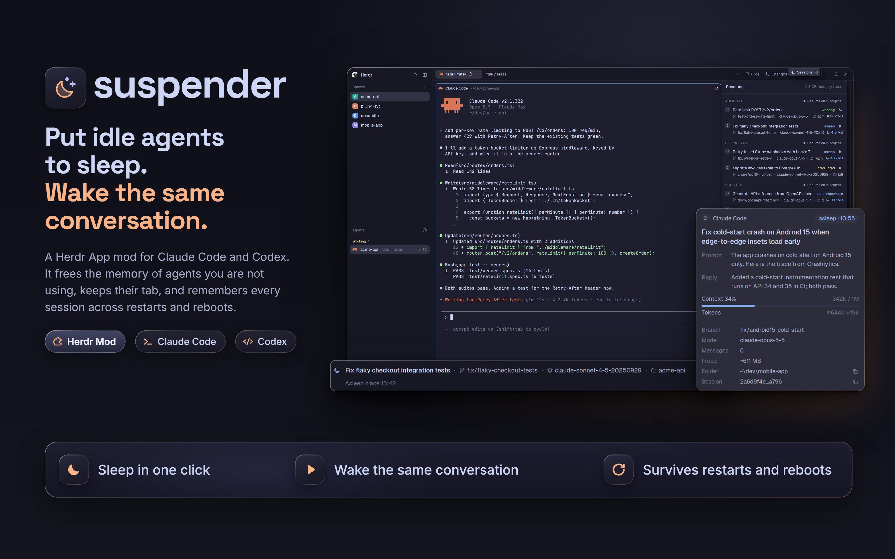

# Suspender

A mod for [Herdr App](https://herdr.dev) that puts idle Claude Code and Codex sessions to sleep and wakes them
in the same tab later, even after Herdr or the whole computer has restarted.



An idle Claude Code session holds 0.6 to 0.9 GB of memory. Closing it frees that but loses your place.
Suspender stops the agent and keeps the tab: the last screen stays, dimmed, with a Resume button. While idle,
the mod itself starts no processes.

- **Sleep** from a pill on the tab, from the Sessions list or with `Alt+Shift+S`.
- **Resume** continues the same conversation in the same tab. A session open elsewhere is never opened twice.
- **Restarts are covered.** After Herdr or the PC restarts, tabs that had an agent wait for you to resume them.
- **Sessions** lists every session of every project with the memory it freed, and wakes a project in one click.

## Install

We recommend the mod together with its layout. That puts a Sessions button in the tab bar, next to Files and
Changes, and makes the keys work everywhere.

<details>
<summary>Mod alone or mod with layout?</summary>

The mod alone still sleeps, resumes and restores tabs, but Sessions opens as a separate window and the keys
work only while a sleeping tab or that window is on screen. The layout is Herdr's standard window plus the
Sessions button, the list in the side panel and the Sleep pill. It updates itself when Herdr does.

</details>

### Ask your agent

This works the same on every system. In any Herdr tab, tell your agent:

> Read ~/.config/herdr-app/AGENTS.md, then add this layout: herdr.dev/layouts/fakie-dev/herdr-suspender--layout

For the mod alone, end with `add this mod: herdr.dev/mods/fakie-dev/herdr-suspender`. If Suspender isn't in
the catalog yet, give the GitHub address instead: `github.com/fakie-dev/herdr-suspender/tree/main/layout` for
the layout, `github.com/fakie-dev/herdr-suspender` for the mod alone.

### By hand

Herdr keeps its files in `.config/herdr-app` in your home folder on every system:
`C:\Users\<you>\.config\herdr-app` on Windows, `~/.config/herdr-app` on macOS and Linux (or under
`XDG_CONFIG_HOME`, if you set it).

Windows, in PowerShell:

```powershell
$herdr = "$HOME\.config\herdr-app"
git clone --depth 1 https://github.com/fakie-dev/herdr-suspender "$env:TEMP\herdr-suspender"
Copy-Item -Recurse -Force "$env:TEMP\herdr-suspender\mods\suspender" "$herdr\mods"
Remove-Item -Recurse -Force "$env:TEMP\herdr-suspender"
herdr-app check "$herdr\mods\suspender"
herdr-app do layout.switch --name suspender
```

macOS and Linux:

```sh
herdr="${XDG_CONFIG_HOME:-$HOME/.config}/herdr-app"
git clone --depth 1 https://github.com/fakie-dev/herdr-suspender /tmp/herdr-suspender
cp -R /tmp/herdr-suspender/mods/suspender "$herdr/mods/"
rm -rf /tmp/herdr-suspender
herdr-app check "$herdr/mods/suspender"
herdr-app do layout.switch --name suspender
```

Skip the last line for the mod alone. Then open `keys.json` in the same folder. Add the first two lines below
inside its `"global"` section, and the last one as a new section next to it. Herdr applies it at once.

```json
"ctrl-shift-s": "mod.open:suspender",
"alt-shift-s": "suspender.toggle-focused",

"layout:suspender": { "ctrl-shift-s": "suspender.panel" }
```

## Use

| Key            | What it does                                                                   |
| -------------- | ------------------------------------------------------------------------------ |
| `Ctrl+Shift+S` | Opens or closes Sessions: the side panel in the layout, a window anywhere else |
| `Alt+Shift+S`  | Sleeps the agent in the focused tab, or resumes the focused sleeping tab       |

On a Mac, Alt is the Option key. To change them, edit `keys.json`; [RECIPE.md](RECIPE.md) lists every command.
Sessions are saved in `suspender/sessions.json` in Herdr's folder, so updating the mod keeps them.

## Updates and the network

Once a day Suspender asks GitHub for its latest release (one request to `api.github.com`, nothing about you is
sent). When a newer version is out you get one notice, and Sessions offers What's new and Update. Update
downloads that release's files from `raw.githubusercontent.com`, checks each one against the release's checksum
list, tries them with `herdr-app check`, and replaces `mods/suspender` and nothing else: your keys, settings,
layouts, other mods and saved sessions stay as they are. The old version is kept, and Roll back restores it. If
you changed the mod's files, the button leaves them alone and tells you how to update by hand.

To turn the check off, untick "Check for updates" at the bottom of Sessions. Then the mod makes no network
requests at all.

## Remove

The mod can't clean up after itself. Do it in this order, or it puts its files back:

1. Switch to another layout with `Ctrl+Shift+L` (`Cmd+Shift+L` on a Mac).
2. In `~/.config/herdr-app`, delete `layouts/suspender.json`, `mods/suspender` and `mods/suspender-tabs`.
3. Remove the `suspender.*` keys and the `layout:suspender` section from your `keys.json`.
4. If you want the saved sessions gone too, delete `~/.config/herdr-app/suspender/` (it also holds the update
   check's state and the backup of the previous version).

## More

- [RECIPE.md](RECIPE.md) and [layout/RECIPE.md](layout/RECIPE.md): full briefs for agents.
- [docs/architecture.md](docs/architecture.md) and [docs/adr/](docs/adr): how it works and why.
- [ROADMAP.md](ROADMAP.md) and [CHANGELOG.md](CHANGELOG.md): what's next and what changed.
- Developing: `pnpm install`, `pnpm check`, then [AGENTS.md](AGENTS.md). Adding an agent is one file, see
  [Adding an agent](docs/architecture.md#adding-an-agent).

Tested on Windows. macOS and Linux should work and CI tests all three, but the mod hasn't been tried there yet:
reports are welcome.

## License

MIT.

The icons in the preview images (the moon-and-stars mark, the puzzle piece, the prompt and the code
brackets) come from [Phosphor Icons](https://phosphoricons.com) (MIT), recoloured.

The agents' icons in Sessions (Claude Code's, Codex's) are Herdr's own: the mod draws the files Herdr ships in
its home folder and names in its program table, and carries no copy of them. Their licenses are in Herdr's
`icons/LICENSES.md`.
