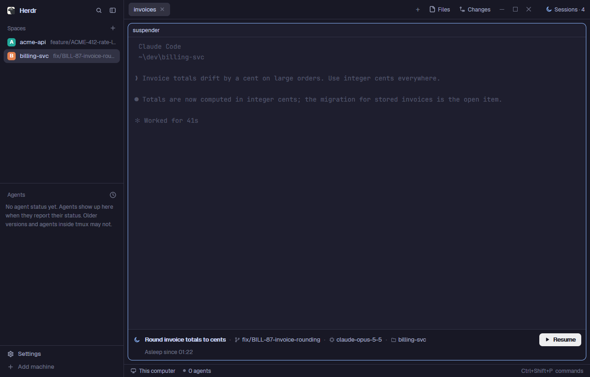

# Suspender

A mod that puts a Claude Code or Codex session to sleep and wakes it in the same tab. A sleeping tab keeps its
place and shows the agent's last screen, dimmed, with a strip at the bottom: session title, branch, model,
folder, and a Resume button. Press Resume and the same conversation continues. After Herdr or the computer
restarts, tabs that had an agent show the same strip and wait; nothing starts by itself. A Sessions list lists
every session of every space.

## What you see

**The strip of a sleeping tab.** It fills the tab where the agent's terminal was, to the pixel. The upper part
is the last screen the agent had, read once when it went to sleep and drawn in the terminal's monospace font at
30% opacity. The strip at the bottom is on the `chrome` background with a 1 px `border` line above it, padded
12 px left, 10 right and 8 top and bottom. First line, from the left: a 14 px moon in the `accent` color (the
`working` color when the session was interrupted by a restart), then the title in the foreground color and
semibold, then branch, model and folder in the `muted` color, each behind its own small icon, all at 12.5 px.
The buttons close the line, 28 px tall with a 7 px radius: Resume is filled with `solid` and its text in
`solid_foreground`, the others have a 1 px `border` and `muted` text; a disabled button uses `raised` and
`dim`. When the line is too narrow, items leave from the end, whole, and a `+N` badge counts them; the title
stays at least half the line. Under it, indented 24 px, a 12 px status line.

The status line under it says one of: `Asleep since 14:05`, `Interrupted by restart · 14:05`, `Stopped
forcefully, conversation kept`, `This session is open elsewhere — close it there to resume here`,
`Conversation no longer exists on disk`. A session that was changed while it slept adds `Updated after sleep ·
<time> · +N messages`.

**The Sessions button.** A block 110 px wide at the right end of the tab strip, after the window buttons, with
a 26 px tall button reading `Sessions · N` (N is the number of sleeping sessions) at 12 px: `muted` on `chrome`,
`foreground` on `selected` while the panel is open, `hover` under the pointer. It opens and closes the panel.

**The Sessions panel.** A column on the right, 320 px wide (200 to 700), hidden until opened. A header with
`Sessions` and the total memory freed (`4.0 GB memory freed`). Below it the spaces in upper case, each with a
`Resume all in project` link. Each session is two lines: the title and a state word (`running`, `asleep`,
`interrupted`, `open elsewhere`, `conversation gone`), then branch, model, folder and a short id, cut from the
end with a `+N` badge, and on the right the memory: the moon and `1.5 GB` for sleeping sessions (freed), a dot
and the figure for running ones (used). Within a space: running sessions, then sleeping, then interrupted.
Empty: `No agent sessions yet — start Claude Code or Codex in any tab`.

**The popup.** About 344 px wide, 350 ms after the pointer rests on a strip or row (60 ms when moving to a
neighbouring row, 180 ms to hide). It holds the title, the first prompt and the last reply (two lines each),
state and time, message count, branch, model, folder and session id (each with a copy button), context use as
a percentage and a bar, tokens, and memory. Facts the agent does not store are left out.

**The pill.** A floating drawer 28 px tall on the right edge of the tab area, 30 px of it peeking out: a moon
at rest, and on hover `Sleep · Claude Code` (11.5 px) for the agent in focus. Draggable; Herdr remembers where.
It draws nothing when no agent has focus.

**The question.** When you sleep an agent that is answering, a small dialog: `Claude Code is still answering`
with `Sleep when done`, `Interrupt and sleep`, `Cancel`.

## How it behaves

Agent statuses are not drawn by this mod; Herdr's own list shows them. A sleeping session is visible only in
Sessions, never in the Agents list.

**Sleep** (pill, row button, `Alt+Shift+S`): the last screen is saved, the agent is stopped (Claude Code: Esc,
wait up to 10 s for idle, `/exit`; Codex: `/quit`; if it is still alive 10 s later the terminal is killed and
the strip says so), a sleeping panel takes the terminal's slot in the layout, and the terminal is closed. The
agent's process and its shell are gone; memory is returned.

**Resume** (strip button, row button, `Alt+Shift+S` on a sleeping tab): checks that the transcript exists and
that no other process holds the session. Then it starts the default shell in a new terminal, types the
resume command into it (`claude --resume <id>`, `codex resume <id>`) in the original folder, checks with `hc
get` that Herdr started the shell it asked for, swaps it into the slot and closes the sleeping panel. The
strip shows `Found session`, `Starting`, `Ready` meanwhile. If the agent does not show up within 30 s, the strip
shows the reason and a Retry button; nothing is retried by itself. After you leave the agent you are in an
ordinary shell.

**Open elsewhere.** If another process has the session, Resume is disabled with the message above. It becomes
active as soon as the session is closed there: Claude Code is watched through its `sessions` folder; Codex is
checked every five seconds while the strip is on screen.

**Restart.** Terminals carry labels `suspender.agent`, `suspender.session` and `suspender.state` (`running` or
`exited`). A terminal that says `running` but holds no agent any more was interrupted by a restart: its strip
says so and waits. If there is any doubt the strip is shown and the agent is not started. An agent you left
yourself with `/exit` is marked `exited` and does not turn into a sleeping tab.

**Changed in the meantime.** If you used the session in another program while it slept, Resume continues the
latest state, and the strip says what changed, read once when it is first shown.

**Gone.** If the transcript is gone, the strip offers `Start new session` (a new agent in the same folder) and
`Forget`. `Forget`, or closing a sleeping tab, deletes the store entry and leaves the transcript alone.

**Resume all in project** wakes the sleeping and interrupted sessions of one space, one after another, and skips
those open elsewhere with a notice.

**Cost.** No redraw timers. Memory of running processes is read only while the panel is open and at most every
30 s. A transcript is read only when a session goes to sleep or when its strip is first shown and the file
changed.

## Built from

One mod, `mods/suspender` (`main.js`, `mod.json`, `icons/*.svg`, compiled from `src/`), with one View whose
copy is chosen by `props.role`: `toggle` (the button), `panel` (the list), `pill`, `sleep` (a sleeping tab,
`props.key` is the session key), `confirm` (the question, an overlay), `popup`, and `window` (the list in a
window, also what `mod.open` gives with no role). `mod.json` is `{"place": "none", "title": "Sessions",
"overlay": {"kind": "window", "key": "suspender", "width": 400, "height": 560}}`: `place: none` keeps Herdr
from docking a copy by itself.

The layout it needs is [`layout/`](layout/RECIPE.md); the mod writes `layouts/suspender.json` itself from Herdr's
`layouts/main.json` and rebuilds it when that changes. The shipped mods are not cloned or edited.

Herdr calls it makes: `pane.split` (with `mod` and `props`), `pane.swap`, `pane.close`, `terminal.kill`,
`tab` and `terminal` reads, `shared` values (`suspender.leader`, `suspender.rev`, `suspender.progress`),
`watchFolder`, `writeTextFile` with an expected value, `openOverlay`, and `hc` (`get`, `read`, `label`, `keys`,
`run`). Commands: `suspender.toggle-focused`, `resume-all`, `forget`, `start-new`, `sleep-when-done`,
`interrupt-and-sleep`, `cancel`. Programs it starts: `hc`; for process memory and liveness on Windows `tasklist`
and `robocopy /L` (file size and time), on macOS and Linux `ps` and `stat`; PowerShell only in rare cases of
ambiguity. It reads `~/.claude/projects`, `~/.claude/sessions` and `~/.codex/sessions` and writes only
`~/.config/herdr-app/suspender/sessions.json`. No network.

One of the copies of the mod leads (a `suspender.leader` stamp, taken over after 15 s of silence): it binds
sessions to terminals and recognizes restarts; the others only draw.

Keys, merged into `keys.json`: `Ctrl+Shift+S` opens the Sessions window (`mod.open:suspender`, `global`) or, in
the `suspender` layout, toggles the panel (`layout.toggle` with `id: suspender-panel`); `Alt+Shift+S` is
`suspender.toggle-focused`.

## Watch out

Herdr gives a mod its props through `props()`, not through `init`. `Buffer` does not decode text and
`fs/promises` has no `stat` and no partial read, so transcripts are read whole and sized with a spawned
`stat`. `hc send` wraps text in a `<hc from=...>` tag when `HC_TERMINAL_ID` is inherited, so stop commands are
typed with `hc keys`. From Git Bash `--argv` is changed by the shell: pass arguments as one JSON object.
After starting an agent check with `hc get` that the command that runs is the one you asked for.

Always do the whole `split`, `swap`, `close` sequence; without the swap the closed pane's share goes to a
neighbour. Insert the sleeping panel before stopping the agent and close the terminal last.

Keys reach only a mod that is shown somewhere in the window. The restart check runs when the first copy of the
mod is shown.

Limits: Claude Code and Codex only. The strip cannot warn about unsent text in the prompt. The text of the last
screen is the screen at the moment of sleep, not a live view. The UI is English only; all texts are in
`src/i18n/en.ts`. A Claude Code that was killed from outside keeps the status Herdr last saw, so the mod does
not notice it vanished until the terminal is restarted.

## Done when

- After Sleep, `hc ls` shows no process of that tab's agent, and a panel of the same size is in its place.
- The strip shows the title, branch, model and folder from the transcript, and Resume.
- Resume brings the same conversation back in the same tab: the agent knows what was said before.
- With the session open in another terminal, Resume is disabled and says why; closing that terminal enables it.
- With the transcript renamed away, Resume turns into `Conversation no longer exists on disk`, `Start new
  session` opens a new agent in the same folder, `Forget` removes the entry.
- Sleeping an agent that is answering asks first; `Sleep when done` sleeps it after the answer.
- `Forget`, or closing a sleeping tab, removes its entry from `sessions.json`.
- Sessions groups by space, shows freed memory, and `Resume all in project` skips a session that is open
  elsewhere.
- `herdr-app check mods/suspender` passes and with the panel closed and the strips idle the mod starts no
  process in 60 seconds.
