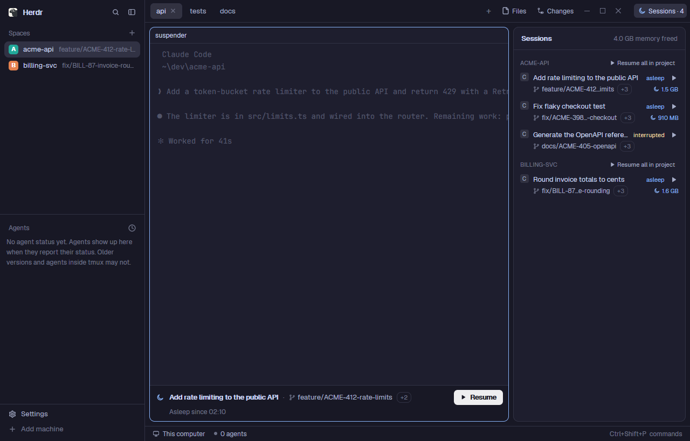

# Suspender window

Herdr's standard window, plus the pieces [Suspender](../RECIPE.md) needs: a `Sessions · N` button at the right
end of the tab strip, a hidden Sessions panel on the right of the work area, and a small Sleep pill on the
edge of the tab area. Nothing from the standard window is removed or moved. Use it when you want Suspender and
its Sessions panel in place from the first minute; without it the mod still works, with Sessions as a window.

## What you see

The window is Herdr 0.1.14's `main` layout, unchanged: the sidebar 268 px wide with Spaces and Agents, the work
column, the 28 px status bar at the bottom. In the work column the tab strip is 42 px tall. Three things are
added.

The tab strip is now a row of two blocks: Herdr's own tabs, taking the free width, and a block 110 px wide at
its right end with the `Sessions · N` button. It sits after the window buttons, because anything to their
right in a block of its own ends up behind them. N counts sleeping sessions.

In the work row, after the Files/Changes column, there is a column 320 px wide (it can be dragged between 200
and 700 px) that starts hidden. Opening it, with the button or `Ctrl+Shift+S`, shows the Sessions list: spaces
in upper case, each session on two lines with its state and the memory it freed or uses, a header with the
total freed.

On the right edge of the tab area a drawer floats, 28 px tall, 30 px of it peeking out: a moon, and on hover
`Sleep · <agent>` for the agent that has focus. It is empty when no agent has focus.

## How it behaves

The button toggles the panel. The pill sleeps the agent in focus (asking first if it is answering). The strip
that replaces a sleeping terminal, the popups and everything else belong to the mod: see its
[recipe](../RECIPE.md). The layout adds the places; the mod fills them.

Herdr's own panels (Files, Changes) work as before and can be shown together with Sessions.

## Built from

`layouts/suspender.json` is `layouts/main.json` of Herdr 0.1.14 with its `cloned_from` set to
`{"name": "main", "version": "0.1.14"}` and a record `suspender_generated` with the hash of the `main.json` it
was made from and the generator version. Three insertions, found by block id or mod name, never by position:

- `suspender-topbar`: a 42 px row that takes the place of the `tabs` block and holds `tabs` (weight 1) and
  `suspender-toggle` (`px: 110`, `content: {mod: "suspender", props: {role: "toggle"}}`).
- `suspender-panel`: the last child of the row that holds the tab block, `hidden: true`, `size: {px: 320}`,
  `min: 200`, `max: 700`, `content: {mod: "suspender", props: {role: "panel"}}`.
- `suspender-pill`: on the node with `content.tab: "active"`, a `floating` entry with `edge: "right"`,
  `align: "end"`, `peek: 30`, `content: {mod: "suspender", props: {role: "pill"}}`.

The mod is `mods/suspender/`, a copy of the one in the first card. Shipped mods (`tabs`, `spaces`, `agents`,
`files`, `changes`, `pane`, `workspace-chrome`, `workspace-status`) are used as they are.

The mod keeps this file current: whenever a copy of it runs it compares the hash of `layouts/main.json` and
Herdr's version with the record, and rebuilds `layouts/suspender.json` if either changed. If Herdr's new
`main.json` no longer has the blocks the insertions need, the last working file stays and one toast says
`Suspender couldn't update its layout for Herdr <version>`. Keys: the mod's `keys.json` adds
`layout:suspender` with `Ctrl+Shift+S` toggling `suspender-panel`.

## Watch out

The button must come after `tabs` in the strip. Put it before and the window buttons, which the tab block
draws at its right edge, end up to its right, behind the next block. Whether the window can still be dragged by
the strip with the button in place has not been checked by hand.

The layout is a snapshot for Herdr 0.1.14. A newer Herdr changes `main.json`, and the mod rebuilds the layout on
its own; if you install this layout without the mod, nothing will. Never clone `main` to get the same result:
the point is that Herdr updates still reach the window.

The panel lists every session of every space, so on a shared screen it shows project names. `mod.json` is
`place: none`; do not change it to `place` something, or Herdr docks a copy of the mod into the window by
itself.

## Done when

- `herdr-app check mods/suspender` passes and `layout.switch suspender` shows the window with no errors in
  `herdr-app status`.
- The right end of the tab strip, after the window buttons, reads `Sessions · 0`; clicking it shows a panel on
  the right, and clicking it again hides it.
- `Ctrl+Shift+S` does the same.
- The window buttons are not covered by the Sessions button.
- Focusing a terminal with Claude Code or Codex makes the Sleep drawer peek out; a plain shell does not.
- `layouts/main.json` is the same as before and `Ctrl+Shift+L` switches back to it.
